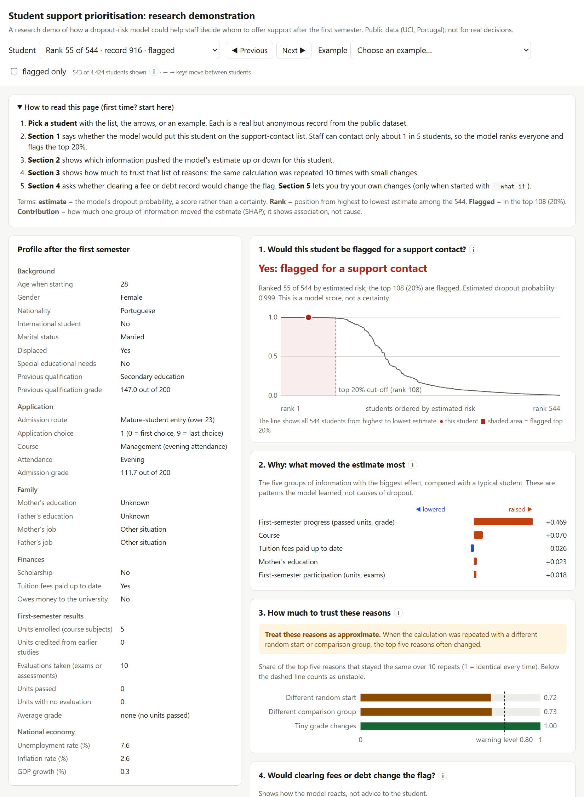
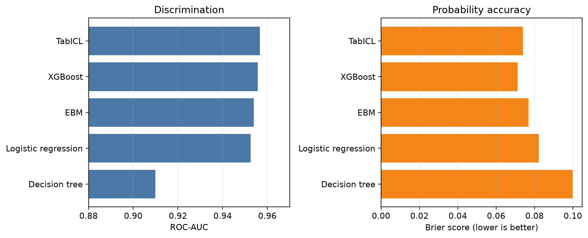
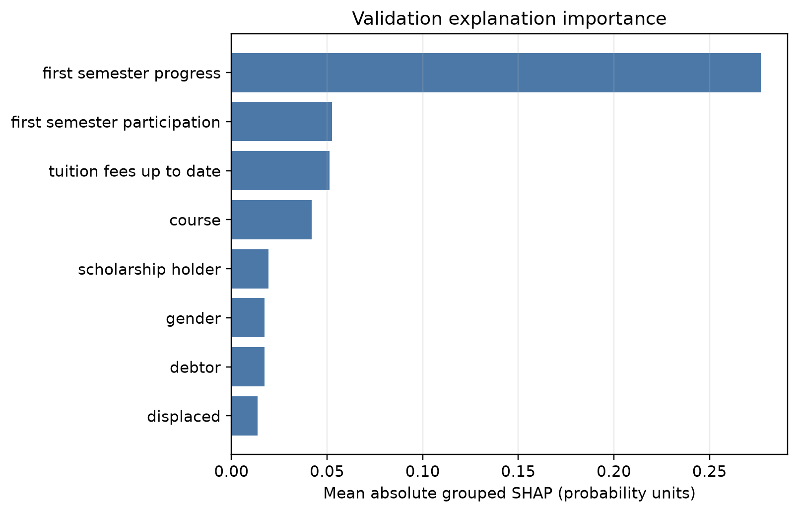
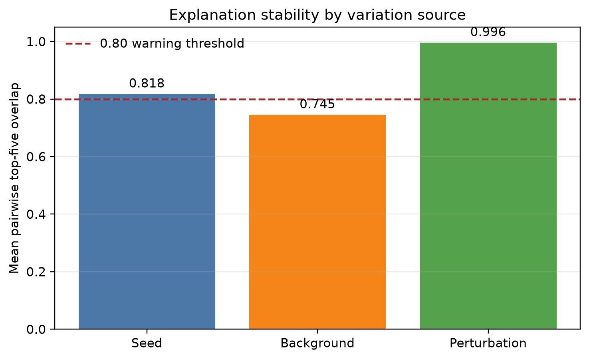
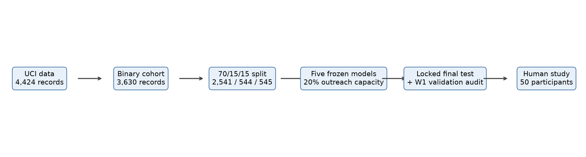
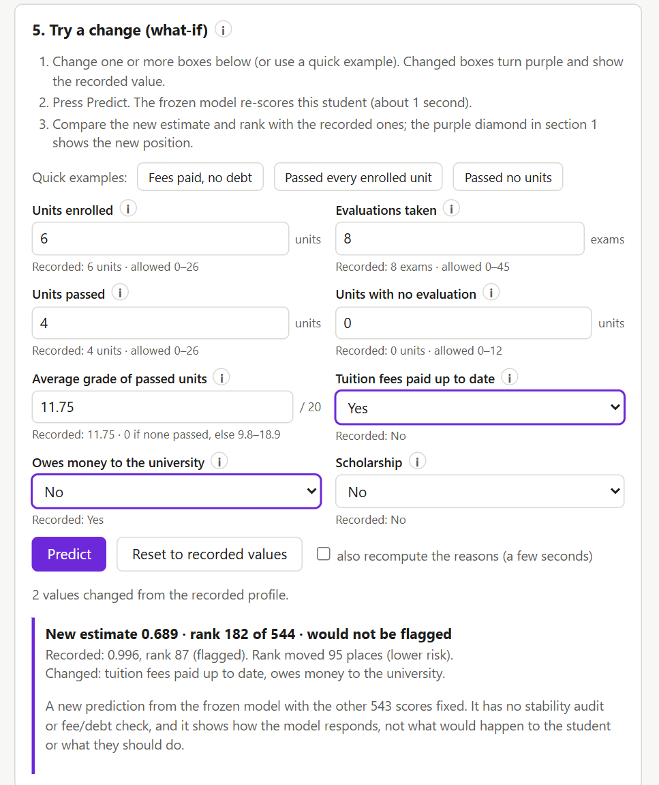

<div align="center">

# 🎓 Trustworthy Explanations for Student Dropout Risk

### Comparing Black-Box and Interpretable Models for Capacity-Limited Student Support

Should a tabular foundation model decide which students a support office contacts first, and can its explanations be trusted? A locked comparison of TabICL with four simpler models, an explanation audit of 544 students and a 50-person human study.

<br>

[](https://python.org)
[](https://github.com/soda-inria/tabicl)
[](https://github.com/shap/shap)
[](https://archive.ics.uci.edu/dataset/697/predict+students+dropout+and+academic+success)
[](#reproducing-the-results)

**Team The Interpreters** · Explainable Data Science (XDS) · Asian Institute of Technology

Aye Khin Khin Hpone (Yolanda Lim) st125970 · Nguyen Liem Son (Lucas) st126729 · Witchayda Theppithuk (Noey) st127419 · Han Htoo Zaw (Han) st127305 · Pyae Sone Han (Harry) st127366

<br>



</div>

---

## Table of Contents

- [Research Questions](#research-questions)
- [Key Findings](#key-findings)
- [Results at a Glance](#results-at-a-glance)
- [Dataset and Decision Setting](#dataset-and-decision-setting)
- [Methodology](#methodology)
- [Local Research Interface](#local-research-interface)
- [Project Structure](#project-structure)
- [Quick Start](#quick-start)
- [Reproducing the Results](#reproducing-the-results)
- [Ethics and Data Privacy](#ethics-and-data-privacy)
- [Limitations](#limitations)
- [Acknowledgements](#acknowledgements)

---

## Research Questions

> **RQ1.** Does TabICL add predictive value over simpler conventional and intrinsically interpretable baselines at a fixed 20% outreach capacity?
>
> **RQ2.** Are its local explanations faithful, stable and appropriately constrained, and what do they reveal to an adviser about the students it flags?
>
> **RQ3.** Do explanation charts help people anticipate the model's outreach flag and identify useful support information?

---

## Key Findings

| | Finding |
|---|---|
| **RQ1: No added value** | TabICL had the highest ROC-AUC (0.957), but it could not be distinguished from XGBoost (Δ 0.001, 95% CI −0.006 to 0.009) or the interpretable EBM (Δ 0.003, −0.007 to 0.014). The transparent EBM is the better choice on this data. |
| **Precision is not the whole story** | 108 of the 109 flagged test students dropped out, but most flagged students had passed no first-semester units, which staff can already see. Only one in five students can be contacted, so recall is capped at 0.51. |
| **RQ2: Faithful but unstable** | SHAP explanations point at what the model uses (positive for 536 of 544 students), but the top five reasons often change when the comparison group changes (411 of 544 students below the 0.80 stability threshold). |
| **Recourse is rare and not causal** | For only 17 of 108 flagged students would clearing fees or debt remove the flag. That is model behaviour, not evidence that paying fees prevents dropout. |
| **RQ3: Charts did not help** | Participants predicted the flag equally well with and without charts (0.900 vs 0.916; Δ −0.016, −0.060 to 0.032). The charts raised confidence, and on one case they misled people. |

---

## Results at a Glance

Locked final test: 545 students, run once. Each model flags its top 20% (109 students).

| Model | ROC-AUC | Brier | ECE | Recall@20% | Precision@20% |
|:---|:---:|:---:|:---:|:---:|:---:|
| Logistic regression | 0.9525 | 0.0822 | 0.066 | 0.507 | 0.991 |
| Decision tree (depth 3) | 0.9099 | 0.0999 | 0.069 | 0.502 | 0.982 |
| XGBoost | 0.9557 | **0.0711** | **0.029** | 0.507 | 0.991 |
| EBM (main effects) | 0.9539 | 0.0768 | 0.040 | **0.512** | **1.000** |
| **TabICL** | **0.9566** | 0.0740 | 0.032 | 0.507 | 0.991 |

<p align="center">
  
</p>

<p align="center">
  
  
</p>

| Human study (25 per group) | Profiles only | + Explanation charts | Difference (95% CI) |
|:---|:---:|:---:|:---:|
| Accuracy (agreement with the model's flag) | 0.916 | 0.900 | −0.016 [−0.060, 0.032] |
| Confidence (1–5) | 4.14 | 4.35 | +0.21 [0.02, 0.42] |
| Self-reported minutes | 33.4 | 30.2 | −3.2 [−8.7, 2.0] |

**Human study:** data collection is complete for all 50 assigned main participants (25 per group). All consented and finished the ten scored cases, and none were excluded.

---

## Dataset and Decision Setting

**Source:** [UCI — Predict Students' Dropout and Academic Success](https://archive.ics.uci.edu/dataset/697/predict+students+dropout+and+academic+success) (dataset 697, CC BY 4.0)

`4,424` students from a Portuguese higher-education institution · `36` predictors · no direct identifiers

| Decision | Choice |
|:---|:---|
| **Who uses it** | A student-support officer, not the student |
| **When** | Once, after the first semester; second-semester data is excluded to prevent leakage |
| **Target** | Dropout (1) vs Graduate (0): 3,630 records. Enrolled students are excluded because their outcome is unknown, and a sensitivity analysis examines them. |
| **Rule** | Rank the cohort and flag exactly the top 20%, the assumed outreach capacity |
| **What a flag means** | "Offer a support conversation", never "withdraw support" |
| **Split** | Stratified 70/15/15, seed 42: 2,541 train / 544 validation / 545 test |

---

## Methodology

<p align="center">
  
</p>

1. **EDA and data design:** training-split profile, leakage removal and a frozen split saved as row IDs
2. **Five models, one rule:** logistic regression, depth-3 tree, XGBoost, main-effects EBM and TabICL (4 ensemble members, CPU), all on the same 33 inputs
3. **Validation-only selection:** every setting was chosen on validation data, then hashed and frozen
4. **One locked final test:** run once on 2 Nov 2026, guarded by a lock file; 2,000 paired bootstrap resamples for model differences
5. **Local explanations:** permutation SHAP (25 background rows, 67 evaluations), summed into semantic groups, top five shown
6. **Explanation audit (all 544 validation students):** faithfulness (ranked vs random deletion), stability (seed, background, grade perturbation), constrained fee/debt recourse, local surrogates and pair masking
7. **Sensitivity analyses:** enrolled students, an admission-time feature window, no protected attributes, students with at least one evaluation
8. **Human study:** two-group forward simulation (profiles only vs profiles plus charts), 10 scored cases, 1,500 written answers coded for themes

---

## Local Research Interface

A self-contained page for the 543 validation students not used in the study. For each student it shows:
- the flag and the student's rank on the cohort risk curve;
- the five main reasons and how stable they are;
- whether clearing fees or debt would change the flag.

An optional **what-if mode** re-scores an edited copy of a student with the frozen model on your own computer.

<p align="center">
  
</p>

> Research demonstration only. It uses validation data, runs locally, was built after the human study and was not tested with users. Results show how the model responds, not what would happen to a student.

Full usage guide, what-if rules and troubleshooting: [`docs/INTERFACE.md`](docs/INTERFACE.md).

---

## Project Structure

```
Student-Dropout-Risk/
├── README.md                  # This page
├── requirements.txt           # Pinned environment (Python 3.12)
├── config/                    # Frozen evaluation protocol
├── eda_uci_data/data/         # UCI source data (read by the pipeline)
├── src/                       # Frozen modelling, explanation and audit code
├── scripts/                   # Runnable steps; see scripts/README.md for the index
├── forms/                     # Google Forms generator and response transform (human study)
├── notebooks/                 # EDA and modelling walkthrough notebooks
├── W1_analysis/               # Full explanation audit of all 544 validation students
├── tables/                    # Saved results (validation, final test, sensitivity, human study)
├── figures/                   # Report figures, demo card, human-study charts
├── artifacts/                 # Split IDs, final-test lock, verification records
├── interface/                 # Built interface page
├── tests/                     # 98 unit tests
├── docs/                      # Detailed documentation (handoff, codebook, study results)
└── Final_Report/              # LaTeX source of the final report
```

---

## Quick Start

```bash
# 1. Clone
git clone https://github.com/TheInterpreters/Student-Dropout-Risk.git
cd Student-Dropout-Risk

# 2. Create the environment (Python 3.12)
python -m venv .venv-core
.venv-core\Scripts\activate          # Windows  (macOS/Linux: source .venv-core/bin/activate)
pip install -r requirements.txt

# 3. Run the tests
python -m unittest discover -s tests

# 4. Open the research interface (saved results, no model needed)
python scripts/launch_interface.py
```

What-if mode (`python scripts/launch_interface.py --what-if`, then open `http://127.0.0.1:8765/`) also needs the frozen model file `data/final_evaluation/selected_model.joblib`. That file is not in the repository; ask the team for it.

---

## Reproducing the Results

```bash
python scripts/reproduce_results.py                       # fast: tests, form checks, report tables/figures, verification
python scripts/reproduce_results.py --validation-results  # adds the slower validation-only model refits (team only, see below)
python scripts/verify_release_readiness.py                # checks every saved number without fitting models
```

- **A fresh clone runs the fast command end to end.** This was checked on a clean clone with no private files: every step passes and the saved results are unchanged.
- **The slower refits need a private file for some steps.** The `--validation-results` steps that compare against the frozen model need `data/final_evaluation/selected_model.joblib`, which is not in the repository.

- **The final test is never rerun.** `artifacts/final_test.lock` records the single run, and `scripts/run_final_test.py` refuses to run again. Its saved outputs are in `tables/final_test/`.
- **Every report figure and table** is regenerated from saved outputs by `scripts/build_report_assets.py`.
- **The human-study tables** are rebuilt from private responses that are not in the repository. The aggregate results are in `tables/human_study/`.
- **A step-by-step script index** is in [`scripts/README.md`](scripts/README.md).

| Package | Version | Used for |
|---|---|---|
| `tabicl` | 2.2.0 | Tabular foundation model |
| `interpret` | 0.7.8 | Explainable Boosting Machine |
| `xgboost` | 3.4.1 | Gradient-boosting baseline |
| `scikit-learn` | 1.9.1 | Logistic regression, tree, preprocessing, metrics |
| `shap` | 0.52.0 | Permutation SHAP explanations |
| `torch` | 2.14.0 | TabICL dependency |

---

## Ethics and Data Privacy

- **Modelling data:** the UCI data is public and anonymised, so no real student records from any institution are used.
- **Participants:** 50 adult volunteers gave informed consent. Answers are stored under random codes, and no names are collected.
- **Private data stays out of Git:** raw responses, the case lookup and the frozen model file are git-ignored and kept in restricted storage. The repository contains aggregate results only.
- **No automated decisions:** the model only orders a contact list for an adviser. It must never be used to deny support or to target students by protected attributes.

---

## Limitations

- **One dataset:** a single Portuguese institution, with no external or temporal validation.
- **Enrolled students excluded:** students without a known outcome were left out, and the 20% capacity is an assumption.
- **Explanations:** they depend on the SHAP budget and the 25-row background. The full audit was run after the final test, on a refit that reproduces the frozen model.
- **Human study:** volunteers acting as proxy users completed it online with ten selected cases. The written answers were coded in a single pass, so agreement was not measured.
- **No causal claims:** nothing here shows what causes dropout or which intervention helps.

---

## Documentation

| Document | Content |
|---|---|
| [`docs/HANDOFF.md`](docs/HANDOFF.md) | Full internal record: methodology, model card (§8), protocol and audit trail |
| [`docs/HUMAN_STUDY_RESULTS.md`](docs/HUMAN_STUDY_RESULTS.md) | Human-study methods and results in detail |
| [`docs/INTERFACE.md`](docs/INTERFACE.md) | Interface user guide, what-if rules and troubleshooting |
| [`docs/QUALITATIVE_CODEBOOK.md`](docs/QUALITATIVE_CODEBOOK.md) | Themes used to code the written answers |
| [`docs/REPRODUCIBILITY.md`](docs/REPRODUCIBILITY.md) | What can and cannot be regenerated, and why |
| [`W1_analysis/README.md`](W1_analysis/README.md) | Explanation-audit package |
| [`forms/README.md`](forms/README.md) | Building and checking the study forms |

---

## Acknowledgements

Sincere thanks to **Dr. Sein Minn** for supervision and guidance throughout this project, to **TA Kaung Hein Htet** for valuable support and feedback, and to the 50 volunteers who took part in the study.

Dataset: V. Realinho, J. Machado, L. Baptista and M. V. Martins, "Predicting Student Dropout and Academic Success," *Data*, 7(11):146, 2022.

---

<div align="center">

**Asian Institute of Technology · Explainable Data Science · 2026**

Team The Interpreters

</div>
