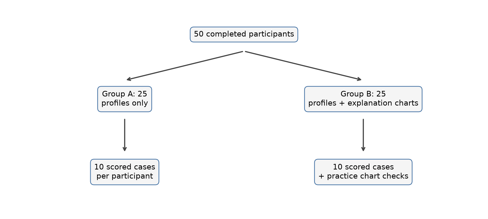
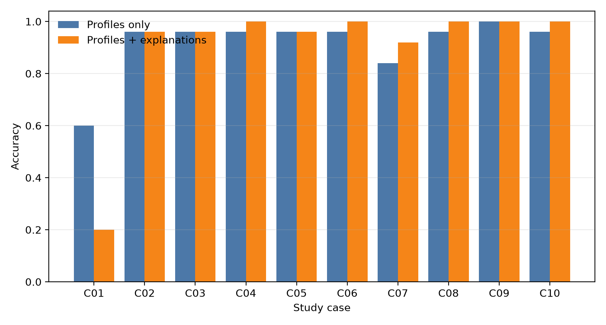

# Completed human study: quantitative results and reproducibility

## Status and integrity

Collection is complete. The received workbook contains exactly the 50 assigned main participants:
13 A1, 12 A2, 12 B1 and 13 B2. Every code matches the sealed assignment and source form. There are
no duplicate, unknown, pilot, declined, under-age, incomplete or excluded responses. The analysis
contains 500 scored case responses (10 per participant), with 25 participants in each group.

The raw workbook, participant-level files and free text are private and intentionally excluded from
Git. Only aggregate tables and figures are committed.



## Primary quantitative result

The pre-specified primary unit is each participant's accuracy across 10 cases.

| Group | n | Mean accuracy | SD | Bootstrap 95% interval |
| --- | ---: | ---: | ---: | ---: |
| Profiles only (A) | 25 | 0.916 | 0.107 | [0.872, 0.956] |
| Profiles + explanation charts (B) | 25 | 0.900 | 0.050 | [0.880, 0.920] |

The exploratory B-minus-A difference is -0.016 (95% stratified-bootstrap interval
[-0.060, 0.032]; two-sided permutation p=0.612; Hedges' g=-0.189). The data therefore do not show
that the charts improved participants' ability to identify the model's flag. This is an absence of
evidence for an accuracy benefit in this small study, not proof that explanations have no value.

Mean confidence was 4.144 in Group A and 4.352 in Group B. The exploratory difference was +0.208
points [0.016, 0.416], with permutation p=0.055 and Hedges' g=0.555. Treat this as exploratory and
do not present it as a confirmatory significant result. Mean self-reported completion time was
33.36 versus 30.16 minutes; the difference was -3.20 minutes [-8.72, 2.04].

## Case-level interpretation

Nine of the 10 cases had equal or higher descriptive accuracy in Group B. C01 was the exception:
accuracy was 0.60 in Group A and 0.20 in Group B. Its explanation chart shows several factors
pushing the model toward greater concern even though the final top-20% cohort-ranking decision is
unflagged. The chart explains contributions relative to a background but does not display the final
cohort boundary, so it may encourage an incorrect “more worried means flagged” inference.

The pre-specified 10-case result must remain primary. As a transparent sensitivity analysis, after
omitting C01 the mean nine-case accuracies are 0.951 and 0.978, a B-minus-A difference of +0.0267
[-0.0133, 0.0756], permutation p=0.376. This post-hoc result does not establish a benefit; it shows
that the overall comparison is sensitive to one interface/case combination.



## Comprehension checks and outcome type

Among the 25 explanation-group participants:

- 22/25 (88%) correctly interpreted bar direction;
- 24/25 (96%) correctly interpreted bar length;
- 21/25 (84%) answered both correctly.

Accuracy was higher for flagged than unflagged cases in both groups: 0.968 versus 0.864 in Group A,
and 0.992 versus 0.808 in Group B. This asymmetry and C01 should be discussed as interface and case-
selection limitations.

The study evaluates comprehension of a model-generated flag in a selected 10-case panel. It does
not evaluate real adviser decisions, student outcomes, intervention benefit, causal validity,
institutional deployment, or fairness in use.

## Reproduce from authorized private inputs

From the repository root, with `.venv-core` activated:

```powershell
python forms/transform_responses.py --workbook data/human_study/scoring_private/exports/response_sheet_study.xlsx `
  --sheets "Form Responses 1" "Form Responses 2" "Form Responses 3" "Form Responses 4" `
  --variants A1 A2 B1 B2 `
  --assignment data/human_study/assignment_list.csv `
  --spec data/human_study/scoring_private/form_spec.json `
  --label study --out-dir data/human_study/analysis

python scripts/analyze_human_study.py data/human_study/analysis/responses_long_study.csv `
  --participants data/human_study/analysis/responses_participants_study.csv `
  --private data/human_study/scoring_private/private_lookup_study.json `
  --label study --out data/human_study/analysis

python scripts/build_human_study_report.py `
  --scored data/human_study/analysis/scored_study.csv `
  --people data/human_study/analysis/participants_study.csv `
  --participants data/human_study/analysis/responses_participants_study.csv `
  --private data/human_study/scoring_private/private_lookup_study.json

python scripts/build_report_assets.py
```

The aggregate output manifest records input and output SHA-256 hashes. The analysis uses seed 42,
10,000 stratified bootstrap resamples and 10,000 label permutations.

## Qualitative responses (descriptive; single coding pass)

All 1,500 written answers (50 participants x 10 cases x 3 questions) were coded once with
`docs/QUALITATIVE_CODEBOOK.md`, one primary theme per answer, and each suggested intervention was
rated on the four proposal section 5.7 items. **The planned independent double-coding of 20% was not
done, so inter-coder agreement was not measured**; treat these counts as one coder's descriptive
summary, not validated themes. Group was joined only after coding. Aggregate tables:
`tables/report_ready/human_study_theme_summary.csv`, `human_study_theme_by_group.csv` and
`human_study_intervention_flags_by_group.csv`.

**Why the model decided (rationale).** With charts, 180/250 answers (72%) explicitly reasoned from the
chart; 40 (16%) cited academic results and 25 (10%) combined several factors. Without charts, answers
split between academic evidence (115/250, 46%) and several combined factors (115, 46%); financial or
administrative reasons were primary in 12 (5%). Personal or demographic reasons were almost never the
primary rationale in either group (2/500).

**Suggested support (intervention).** Across all answers: academic support 30%, no action 21%
(mostly praise or "keep it up" for students the model did not flag), advising or monitoring 16%,
financial or administrative support 15%, verify or gather information first 11%, wellbeing or
social support 2%, unclear 5%. For flagged cases, financial/administrative support (29%), academic
support (30%) and first finding out what happened (20%) dominated; for unflagged cases, no action
(40%) and academic support (30%) did. By group, financial support was suggested in 44/250 answers with
charts vs 32/250 without, and no action in 48 vs 57; these are small descriptive differences without
an uncertainty estimate.

**Intervention ratings (proposal section 5.7).** 76% of suggestions named a concrete next step
(Group A 71%, Group B 82%; on unflagged cases 53% vs 74%), 91% could start before the second semester
in both groups, and 2.8% asserted an unsupported cause (for example that debt or course fit explains
the result; A 4.0%, B 1.6%). The actor was the institution in 35%, the student alone in 19% and both
in 41%; Group B more often placed the action with the institution (42% vs 27%).

**What else participants wanted to know (missing information).** Academic engagement such as
attendance, whether the student is still enrolled, and which unit was failed (40%); personal
circumstances such as work, family, housing or living away from home (26%); course or programme
context such as course choice, transfer or prerequisites (12%); finances (10%); nothing (6%);
unclear or blank (6%; 15 answers were "-"). Prior support contact was requested once. This points to
attendance/enrolment status and work or family commitments as the information the profiles lacked.

**Paraphrased examples (not quotations).** Rationale with charts: the long bars for first-semester
results pushed the estimate towards a flag. Suggestion for a flagged case: contact the student about
the unpaid fees, offer a payment plan, then arrange tutoring for the failed units. Unsupported cause:
fee debt is what pushes students to leave. Missing information: whether the student is still attending
and how many hours they work.

**Response-quality caveat.** Some answers are generic or repeated: 18 intervention answers repeat
the same participant's earlier text, and 21 intervention answers (35 missing-information answers)
match another participant's answer word for word. A few participants answered with motivational
phrases or one word. These answers were coded as written and nobody was excluded, but the report
should mention that written-answer depth varied and some answers appear templated.

Primary aggregate sources: `tables/human_study/group_summary.csv`,
`tables/human_study/group_comparisons.csv`, `tables/human_study/case_summary.csv`,
`tables/human_study/leave_one_case_out.csv`, and `tables/human_study/practice_checks.csv`.
